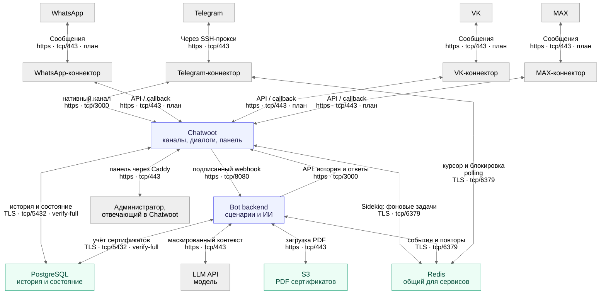

# Целевая архитектура Невидимого фонда

На рисунке — единая архитектура для Telegram, WhatsApp, VK и MAX, без отметок
этапа реализации и деталей размещения на сервере. Это целевая схема, а не
инвентаризация работающих интеграций: реализован Telegram-контур;
код изолированных коннекторов WhatsApp и VK добавлен отдельно, MAX пока не реализован.
Настройка и границы проверки новых каналов: [коннекторы](messenger-connectors.md).
Связи действующего контура сверены с обработчиками, API-клиентом и Timeweb
Compose-файлами. Внутренний TLS активирован и проверен на сервере
20 октября 2026 года; последующая проверка релиза `9c61ea5` подтвердила
сохранность TLS-конфигурации и сертификатов.
Это прикладная схема обмена данными, не схема firewall: Caddy,
Sidekiq и локальные тома не вынесены в отдельные блоки. Redis показан как
общая зависимость трёх компонентов; его роль описана ниже.
Доступность сервера этой схемой не подтверждается.

GitHub отображает Mermaid ниже без плагинов. Для просмотра отдельной картинки:
[SVG](diagrams/architecture-2.svg) · [PNG](diagrams/architecture-2.png).
Исходная картинка сохранена как `architecture-1.png`.



Подписи отражают проверенный после включения TLS Timeweb-контур. HTTPS до
Telegram сохраняется внутри прокси-туннеля; внешний переход прокси защищён SSH.
Общая панель — [chatwoot.admin.nevidima.ru](https://chatwoot.admin.nevidima.ru/):
браузер подключается к Caddy по HTTPS:443 без SSH-туннеля, а Caddy проверяет
внутренний сертификат Chatwoot на HTTPS:3000. HTTP:80 только перенаправляет
на HTTPS. Внутренние порты 3000, 8080 и 6379 наружу не опубликованы.

Telegram ingress и бэкенд обращаются к Chatwoot по HTTPS:3000. Подписанный
Agent Bot webhook идёт на HTTPS:8080; подпись сохранена дополнительно к TLS.
Managed PostgreSQL:5432 использует `verify-full` с отдельным CA Timeweb;
внутренний CA приложения его не заменяет. Rails/Sidekiq, бэкенд и Telegram
ingress используют общий Redis:6379 по TLS (`rediss://`) с проверкой сертификата.
При живой проверке незашифрованные подключения к внутренним HTTP-сервисам
и Redis были отклонены.

Действующий [режим внутреннего TLS](chatwoot-operations.md#внутренний-tls-подготовленный-режим)
выбирается общим Compose entrypoint для ручных команд и systemd. Публичный
сертификат панели и внутренние сертификаты — разные наборы. Их пути,
ключи и значения секретов на схему не выносятся.
S3 и LLM используют HTTPS endpoint. HTTPS для WhatsApp, VK и MAX — требование
к внешним интеграциям: каналы WhatsApp и VK ещё не подключены, MAX остаётся
планом. Маскирование перед LLM не заменяет шифрование сетевых соединений.

В Chatwoot видна вся переписка. Бот продолжает отвечать после уведомления команды
и замолкает, когда разговор берёт человек. Ответы человека идут в тот же Telegram-чат.
На схеме показан администратор, отвечающий в Chatwoot. Дежурная, юрист и
психолог работают через ту же панель; это название блока, не изменение прав.

Все коннекторы на рисунке показаны на одном логическом уровне: они обеспечивают
обмен сообщениями между мессенджером и Chatwoot. Это границы ответственности,
а не отдельный контейнер на каждый прямоугольник.

Telegram-коннектор объединяет существующий `telegram-ingress`, штатный
Telegram-адаптер Chatwoot и транспорт через прокси. Входящие обновления забирает
ingress через `getUpdates` и передаёт штатному Telegram endpoint Chatwoot;
через aiogram он также подтверждает нажатия кнопок. Ответы диалога отправляет
нативный Telegram-канал Chatwoot/Sidekiq через `telegram-proxy` и получает
подтверждения Bot API. Исходящие ответы не проходят через ingress.
Штатный адаптер физически находится внутри Chatwoot, но включён в логический
блок коннектора; схема не предполагает его переноса в отдельный сервис.
Поэтому на обзорном рисунке одна цепочка `Telegram ↔ коннектор ↔ Chatwoot`,
как у остальных источников, а прокси отмечен только на внешнем соединении.

Бот-бэкенд получает события от Chatwoot через webhook, сохраняет их в Redis,
затем обработчик читает историю и сохраняет ответы через Chatwoot API.
Это две отдельные стрелки: `Chatwoot → backend` — POST-события Agent Bot,
`backend → Chatwoot` — API-запросы истории, состояния, ответов и назначений.
Webhook бэкенда и Telegram webhook — разные интерфейсы. При polling Telegram
webhook отключается, но доставка событий Chatwoot в бэкенд остаётся через webhook.
Прямой доступ бэкенда к PostgreSQL нужен только для учёта сертификатов.
PDF бэкенд загружает из S3, затем передаёт файлом в Chatwoot; отправленное вложение
Chatwoot хранит в собственном Active Storage, сейчас на локальном томе.
LLM вызывается нашим бэкендом, не Chatwoot; перед отправкой контекст маскируется.
Общий Redis используется Chatwoot для Sidekiq, бэкендом для очереди событий
и Telegram-ingress для курсора и блокировки; отдельного Redis у бэкенда нет.
Стрелка Telegram-коннектор ↔ Redis относится именно к polling-приёмнику,
а не к прокси. Коннекторы WhatsApp и VK используют каждый свой Redis в отдельном
Compose-проекте, без доступа к Redis Telegram/Chatwoot. На обзорной картинке эти
два изолированных хранилища не показаны; схема размещения приведена в
[описании коннекторов](messenger-connectors.md). MAX ещё не реализован.

## Проверка связей по коду

| Связь на рисунке | Основание |
| --- | --- |
| Telegram ↔ Telegram-коннектор через прокси | `Ingress.poll_once`: `get_updates`, подтверждение callback, `AiohttpSession(proxy=proxy)`; исходящие ответы штатного адаптера — через `http_proxy` / `https_proxy` Rails и Sidekiq; [telegram_ingress.py](../app/chatwoot/telegram_ingress.py), [Compose](../deploy/chatwoot/compose.yml), [proxy.py](../app/chatwoot/proxy.py) |
| Telegram-коннектор ↔ Chatwoot | Вход: `Ingress.forward` передаёт обновления нативному Telegram endpoint. Выход: штатный `telegram_channel` создаётся в `activate.connect` и отправляет ответы; логический блок включает этот встроенный адаптер; [telegram_ingress.py](../app/chatwoot/telegram_ingress.py), [activate.py](../deploy/chatwoot/activate.py) |
| Chatwoot → бэкенд, webhook | `outgoing_url` Agent Bot в [bootstrap.py](../deploy/chatwoot/bootstrap.py) и [activate.py](../deploy/chatwoot/activate.py); POST route в [app.py](../app/chatwoot/app.py) |
| Бэкенд → Chatwoot, API | `ChatwootClient.get_messages`, `set_custom_attributes`, `send_reply`, назначения; [client.py](../app/chatwoot/client.py) |
| Chatwoot ↔ PostgreSQL | Подключения Rails и Sidekiq к одной БД `chatwoot`; [Compose](../deploy/chatwoot/compose.yml) |
| Бэкенд ↔ PostgreSQL | `CertificateInventory`, `database_url`, таблицы `women_help_*`; [certificates.py](../app/chatwoot/certificates.py) |
| Бэкенд ↔ LLM | `YandexAgentGateway.evaluate`, `_call_live`, `format_redacted_transcript`; [agents.py](../app/agents.py) |
| Бэкенд ↔ S3 | `_send_certificate` загружает PDF через `S3CertificateObjectStore.download`; [service.py](../app/chatwoot/service.py), [certificate_documents.py](../app/certificate_documents.py) |
| Администратор ↔ Chatwoot | Панель Chatwoot; `parse_staff_message` и `_staff_message` обрабатывают ответ сотрудника; [contracts.py](../app/chatwoot/contracts.py), [service.py](../app/chatwoot/service.py) |
| Chatwoot ↔ Redis | Один `REDIS_URL` у Rails и Sidekiq, `redis-server --appendonly yes`; [Compose](../deploy/chatwoot/compose.yml) |
| Бэкенд ↔ Redis | `Redis.from_url` и `DurableEventQueue`: запись, чтение, подтверждение и повторы событий; [__main__.py](../app/chatwoot/__main__.py), [event_queue.py](../app/chatwoot/event_queue.py) |
| Telegram-коннектор ↔ Redis | Чтение и сохранение offset, распределённая блокировка polling; [telegram_ingress.py](../app/chatwoot/telegram_ingress.py) |
| WhatsApp / VK ↔ свои коннекторы ↔ Chatwoot | Изолированные адаптеры `app/connectors`, API inbox и callback URL; запуск и тесты: [коннекторы](messenger-connectors.md). MAX остаётся целевым расширением |

## Как проходит сообщение

1. Telegram ingress получает обновление через исходящее polling-соединение и
   передаёт его штатному Telegram endpoint Chatwoot. Нативный webhook остаётся
   альтернативным транспортом; одновременно с polling его не включаем.
2. Chatwoot/Sidekiq сохраняют сообщение и отправляют событие Agent Bot. Python
   подтверждает приём после записи в Redis Streams; обработчик сохраняет порядок
   внутри диалога и повторяет незавершённые события после перезапуска.
3. Обработчик читает из Chatwoot историю, состояние и назначение специалиста.
   Если разговор ведёт человек, автоматического ответа на обычный текст нет.
4. Для свободного текста Presidio маскирует контекст перед двумя параллельными
   LLM-вызовами: диагностика риска и поддержка/потребности. Сценарии, проверка
   структурированных результатов и side effects остаются в Python. На отдельных
   маршрутах есть дополнительный вызов выбора команды; не каждый клик вызывает LLM.
5. Ответ, кнопки, заявки, опросы и обновления состояния возвращаются в Chatwoot
   через API. Chatwoot/Sidekiq доставляют ответ в исходный канал. Уведомление
   команде само по себе не выключает бота — назначение конкретного специалиста
   переключает владельца ответа.

## Где хранятся данные

| Данные | Источник истины | Кто пишет |
| --- | --- | --- |
| Переписка, контакты, inbox, команды, назначения | Таблицы Chatwoot в PostgreSQL | Chatwoot; Python — через Chatwoot API |
| Состояние сценария, навигация, заявки, задания опросов, диагностические метаданные | `conversations.custom_attributes` в Chatwoot | Python через Chatwoot API |
| Учёт и резервирование сертификатов | `women_help_*` в той же PostgreSQL `chatwoot` | `CertificateInventory` напрямую через SQLAlchemy |
| Исходные PDF сертификатов | S3 | импорт/админ-бот; Agent Bot читает при выдаче |
| Отправленные вложения | Active Storage Chatwoot, сейчас persistent volume | Chatwoot/Sidekiq |
| Ожидающие события и повторы, Sidekiq, polling offset/lease | Redis с AOF | соответствующие обработчики |
| Сценарии, каталог помощи, проверенная база знаний | файлы репозитория | команда через Git |

Redis Streams временно содержат payload ожидающего события, включая его текст.
После успешной обработки запись удаляется. Это транспортная очередь, не вторая
каноническая история. AOF и persistent volumes не заменяют резервные копии.
У Python нет отдельной БД диалогов; старая standalone-БД не входит в эту схему.

## Будущие каналы и переезд

- **WhatsApp и VK:** реализованы отдельные коннекторы к API inbox Chatwoot.
  Входящие сообщения и действия кнопок коннектор записывает через Chatwoot API;
  исходящие публичные сообщения получает через callback URL своего API inbox
  и доставляет в мессенджер. Callback вызывается и для других событий: коннектор
  должен отфильтровать входящие сообщения и приватные заметки, не пересылая их
  обратно клиентке. Внешние идентификаторы сохраняются в контактной привязке
  Chatwoot; коннекторы не пишут напрямую в PostgreSQL и не вызывают бот-бэкенд.
  Их публикация и приёмка с реальными аккаунтами выполняются отдельно.
  MAX остаётся планом; встроенный WhatsApp-канал Chatwoot в этой реализации
  не используется.
- Всем inbox подключается тот же Agent Bot. Продуктовую логику не дублируем,
  но форматы кнопок, вложений и callbacks проверяем и адаптируем для каждого
  канала. Автоматическое объединение одной женщины из разных мессенджеров
  не подразумевается: оно требует отдельного решения по идентификации.
- Парсер бэкенда уже принимает Chatwoot `contact_id`, `conversation_id` и
  `inbox_id`, не требуя Telegram ID. Адаптеры преобразуют `input_select` в кнопки,
  обрабатывают клики и вложения. Для API inbox подтверждение принятия всех частей
  сохраняется приватной квитанцией; `wait_for_external_delivery()` принимает её
  только для `Channel::Api`. Telegram продолжает ждать нативный `source_id`.
  Локальные тесты и живую приёмку каналов проводят отдельно.
- Целевой облачный контур: **одна VM с контейнерами + один Managed PostgreSQL**,
  S3 и оплачиваемый по токенам LLM API. Kubernetes для этой схемы не требуется.
  Действующий контур по подтверждению пользователя — Timeweb VM и Managed
  PostgreSQL; он описан в эксплуатационной документации. Локальная БД в базовом
  Compose относится к прежнему контуру, а Timeweb managed-overlay удаляет её.
- В действующем Timeweb-контуре LLM — Timeweb AI Gateway / DeepSeek через
  Chat Completions. Сохранившаяся Yandex-ветка кода использует Responses,
  но не является активным провайдером production. Выбор провайдера не меняет
  владение историей, очередями и интерфейсом специалиста.

## Обновление картинки

Единственный редактируемый источник диаграммы — Mermaid-блок в этом файле.
SVG и PNG — генерируемые артефакты, их нужно обновлять вместе с источником.
Для рендера нужен Node.js 22.13+; runtime Python-приложения от Node не зависит.
Из корня репозитория:

```bash
npx --yes --package @mermaid-js/mermaid-cli@12.0.0 mmdc -i docs/architecture.md -o docs/diagrams/architecture-2.svg -b white --size 2200
mv docs/diagrams/architecture-2-1.svg docs/diagrams/architecture-2.svg
npx --yes --package @mermaid-js/mermaid-cli@12.0.0 mmdc -i docs/architecture.md -o docs/diagrams/architecture-2.png -b white --size 2200 -s 2
mv docs/diagrams/architecture-2-1.png docs/diagrams/architecture-2.png
```

CLI извлекает Mermaid из Markdown и добавляет номер диаграммы к имени файла;
команды `mv` сохраняют результат как `architecture-2.svg` / `architecture-2.png`.
Внешнему сервису рендеринга диаграмма не отправляется.
Проверка этой версии: Mermaid и Chromium локально сгенерировали оба формата,
SVG прошёл XML-проверку, PNG просмотрен на читаемость и пересечения.
Это проверка документации; live-приёмка новых коннекторов не проводилась.

## Основания

- Реализация: [Compose](../deploy/chatwoot/compose.yml),
  [внутренний TLS](../deploy/chatwoot/compose.tls.yml),
  [публичный HTTPS и Caddy upstream](../deploy/timeweb/Caddyfile.tls-domain-https),
  [единый выбор Compose overlays](../scripts/chatwoot_compose.py),
  [запуск Agent Bot](../app/chatwoot/__main__.py),
  [обработка диалогов](../app/chatwoot/service.py),
  [очередь событий](../app/chatwoot/event_queue.py),
  [Telegram ingress](../app/chatwoot/telegram_ingress.py),
  [Telegram proxy](../app/chatwoot/proxy.py),
  [Agent Bot webhook](../app/chatwoot/app.py),
  [Chatwoot API client](../app/chatwoot/client.py),
  [LLM gateway](../app/agents.py),
  [учёт сертификатов](../app/chatwoot/certificates.py).
- [Поддержка Mermaid на GitHub](https://docs.github.com/en/get-started/writing-on-github/working-with-advanced-formatting/creating-diagrams).
- [API inbox Chatwoot](https://www.chatwoot.com/hc/user-guide/articles/1677839703-how-to-create-an-api-channel-inbox).
