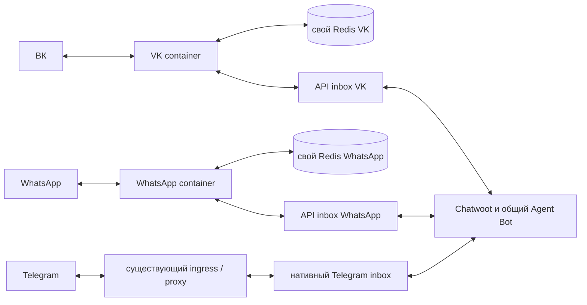

# ВК и WhatsApp: изолированные коннекторы

Реализованы VK Community Callback API и официальный WhatsApp Cloud API.
Оба работают через собственные **API inbox Chatwoot**. История, назначения,
состояние бота и ответы специалистов остаются в Chatwoot. Коннекторы не вызывают
LLM, не импортируют Telegram SDK и не подключаются к PostgreSQL.
Подключение реальных сообществ/номеров и доставка через провайдеров требуют
отдельной настройки и проверки; наличие кода не означает включённый канал.

Рабочая и MVP-версии `nevidima_bot` / `nevidima_mvp_bot`:
[четыре профиля, аккаунты и найденные навыки](connector-bot-accounts.md).

## Границы изоляции

Каждый провайдер запускается отдельным Compose-проектом из
`deploy/connectors/compose.yml`: свой процесс, образ с отдельным тегом, env-файл,
API-пользователь и inbox, Redis, AOF-том, сети, webhook и порт.
Этот файл **не объединяют** с Compose Chatwoot или Telegram.
Запуск/остановка ВК не пересоздают WhatsApp, Chatwoot, Sidekiq, Agent Bot,
Telegram ingress или Telegram proxy. Образ содержит только `app/connectors` и
пустой `app/__init__.py`; зависимости собираются отдельно от основного `uv.lock`.
Файл `Containerfile.dockerignore` ограничивает build context кодом коннектора.

На проект выделено до 192 MiB / 0.5 CPU для Python и 128 MiB / 0.25 CPU для
Redis. Redis недоступен извне, использует собственную внутреннюю сеть и
`noeviction`: переполнение приводит к 503 на webhook и повтору провайдером.
У коннектора не больше двух одновременных JSON-запросов, четыре последовательные
очереди и блокировка единственного экземпляра с продлением аренды.
Потеря аренды закрывает приём новых webhook с 503 и завершает только процесс
коннектора; его restart policy восстанавливает обработчик и pending work.

Общие точки зависимости — VM, публичный TLS-терминатор, Chatwoot и Agent Bot.
Изоляция процессов и лимиты не устраняют отказ общей VM или Chatwoot. При сбое
Chatwoot коннектор сохраняет незавершённую работу и повторяет запросы.



## Контракт с Chatwoot

1. Создать **два новых API inbox**, включить `hmac_mandatory`, назначить каждому
   того же Agent Bot, что используется для Telegram. POST
   `/api/v1/accounts/{account}/inboxes/{inbox}/set_agent_bot` принимает
   `{"agent_bot": BOT_ID}`. Telegram inbox не редактировать.
2. Для каждого коннектора создать отдельного служебного пользователя с ролью
   agent и доступом только к его inbox. В env передать его API token.
   Администратор отдельно получает `inbox_identifier` и `hmac_token` API inbox.
   Коннектору не нужны admin token, Agent Bot token, Telegram token или ключи LLM.
3. Создать независимый случайный `CONNECTOR_CALLBACK_SECRET` из 32–128 символов
   `A-Z`, `a-z`, `0-9`, `_`, `-`, например `secrets.token_urlsafe(32)`.
   Callback URL API inbox:
   `https://vk-connector.example.org/webhooks/chatwoot/SECRET` либо
   `https://wa-connector.example.org/webhooks/chatwoot/SECRET`.
   API-inbox callbacks в Chatwoot 4.12.1 не подписаны отдельным HMAC;
   поэтому HTTPS и секрет URL обязательны. Access logs коннектора отключены;
   proxy не должен записывать секретный callback URL и Meta verify token.
4. При запуске процесс проверяет тип inbox, его identifier, обязательность HMAC
   и путь callback. Указание Telegram inbox останавливает запуск до приёма работы.

Входящая личность привязана к `provider:community_or_phone:peer` через
ContactInbox `source_id`. HMAC подписывает такой же identifier. Автоматического
объединения контактов разных мессенджеров нет. Входящее сообщение создаётся через
Application API с `message_type=incoming` и отдельным внешним `source_id`.
Существующий разговор выбирается только внутри нужного inbox.

На callback принимаются только `message_created`, публичные `outgoing` и нужные
`account.id` / `inbox.id`. В очередь кладутся только идентификаторы сообщения и
разговора. Перед отправкой заново читаются каноническое сообщение, приватность,
inbox и ContactInbox адресата. Заметки, события обновления и входящие сообщения
не отправляются обратно в мессенджер.

Поддерживаются текст, `input_select`, ответы на кнопки и файлы, включая PDF.
ВК получает текстовые inline-кнопки группами до шести строк; WhatsApp получает
до трёх reply buttons либо списки до десяти вариантов. Длинные варианты
WhatsApp показаны полностью в тексте, короткие кнопки получают уникальные номера.
Кнопки возвращают исходные машинные значения. Входящие документы/фото ВК и
image/document/audio/video WhatsApp передаются вложениями в Chatwoot. Голосовые
сообщения не расшифровываются, изображения не анализируются коннектором.
Неподдерживаемые вложения ВК представлены отметкой в переписке.

Максимальный размер файла и суммарных входящих вложений — 20 MiB по умолчанию.
Загрузка разрешена только с проверенных доменов провайдера или Chatwoot;
дополнительные S3/Active Storage hosts перечисляются точно в
`CONNECTOR_ATTACHMENT_HOSTS`. Редиректы перепроверяются, bearer не передаётся
на другой origin. В логах нет текстов, ответов API или значений секретов.

После принятия **всех** частей провайдером создаётся приватная заметка с
`content_attributes.connector_delivery_receipt`:

```json
{"message_id": 123, "provider": "vk", "external_ids": ["external-id"]}
```

Она подтверждает приём API провайдера и позволяет общему Agent Bot завершить
выдачу PDF. Это не подтверждение прочтения адресатом. Единственное изменение
общего runtime — поддержка такой квитанции в `wait_for_external_delivery()` для
`Channel::Api`. Нативный Telegram по-прежнему ждёт собственный `source_id`.
Эту версию Agent Bot следует выпустить **до** включения новых inbox.
WhatsApp `delivered` / `read` / `failed` обрабатываются отдельно по подписанным
status webhook: статус всего сообщения повышается после подтверждения всех
частей, отказ любой части помечает сообщение failed. Поздний `sent` не понижает
уже сохранённый статус. ВК подтверждает принятие через `messages.send`.

Очередь подтверждает webhook после записи в Redis Streams; успешные записи
удаляются. Транспортные квитанции и соответствия внешних ID живут 30 дней.
Повторы сверяются с Redis, а неопределённый исход входящего POST дополнительно
проверяется по двум последним страницам Chatwoot. ВК использует стабильный
`random_id` для каждой части исходящего сообщения.
Гарантия — bounded at-least-once: у WhatsApp нет ключа идемпотентности отправки.
Потеря HTTP-ответа после принятия сообщения или сбой между ответом провайдера и
сохранением квитанции могут привести к повтору. AOF не заменяет резервную копию.

## Настройка провайдеров

**ВК:** включить сообщения сообщества, создать community token с правами
сообщений и документов. В Callback API включить `message_new`, задать secret,
скопировать confirmation code, указать
`https://vk-connector.example.org/webhooks/vk`. Проверяются secret и group ID.
Коннектор обслуживает личные чаты; сообщения групповых бесед игнорируются.

**WhatsApp:** нужен Meta Business/WABA, подключённый номер и Cloud API token с
правами отправки/медиа. В env указать WABA ID, Phone Number ID, app secret,
независимый verify token и поддерживаемую приложением Graph API version.
Подписать приложение на поле `messages` нужной WABA; callback:
`https://wa-connector.example.org/webhooks/whatsapp`. GET подтверждает challenge,
POST проверяется HMAC SHA-256 по исходному телу запроса и app secret.
Проверяются WABA и Phone Number ID, статусы не запускают диалог бота.

Свободные ответы доступны в течение 24 часов после сообщения пользователя.
Повтор старого webhook не продлевает окно. За пределами окна отправка получает
failed (`131047`); автоматические напоминания через неделю и инициативные
сообщения специалиста потребуют отдельно одобренных шаблонов Meta.

## Независимый запуск и откат

Шаблоны настроек: `deploy/connectors/vk.env.example` и
`deploy/connectors/whatsapp.env.example`. Скопировать в отдельные root-only
файлы `/etc/women-help-vk.env` и `/etc/women-help-whatsapp.env`, заполнить поля.
Использовать разные версии образов и порты (8091, 8092). HTTPS-терминатор должен
направлять отдельные домены коннекторов на эти loopback-порты хоста; `localhost`
внутри контейнерного proxy обозначает сам proxy, а не хост VM.
Публичные callback должны проходить проверку SafeFetch Chatwoot; не отключать
его защиту приватных сетей и не добавлять маршруты коннекторов в Telegram proxy.

```bash
docker compose -p women-help-vk --env-file /etc/women-help-vk.env \
  -f deploy/connectors/compose.yml up -d --build
docker compose -p women-help-whatsapp --env-file /etc/women-help-whatsapp.env \
  -f deploy/connectors/compose.yml up -d --build

docker compose -p women-help-vk --env-file /etc/women-help-vk.env \
  -f deploy/connectors/compose.yml stop
```

Остановка сохраняет очередь; для возврата используется `up -d` того же проекта.
Не удалять том с pending work. Для обновления или отката менять тег только в
env нужного канала и выполнять `up -d --no-deps connector` с тем же `-p`.
Для сборки в managed environment передать публичный CA bundle как BuildKit
secret `proxy_ca`; он не сохраняется в образе.

## Раздельные тесты

| Команда | Граница проверки |
| --- | --- |
| `just test-vk` | VK adapter и его webhook, синтетический HTTP |
| `just test-whatsapp` | Cloud API adapter и webhook, подпись, окно, кнопки, PDF |
| `just test-connectors` | Только отдельный runtime: квитанции, повторы, изоляция, очередь |
| `just test-connector-chatwoot` | API-контракт, фильтры приватности, подтверждение PDF |
| `just test-chatwoot` | Существующий набор Chatwoot, отдельно от коннекторов |
| `just test-telegram` | Существующий транспорт Telegram, отдельно от новых каналов |

Для настоящих Redis-проверок очереди указать `CONNECTOR_TEST_REDIS_URL` на
одноразовый локальный Redis. Каждый тест использует уникальный namespace и
удаляет только свои ключи; без переменной эти проверки явно пропускаются.
Провайдерские тесты не требуют Redis, Chatwoot, API credentials или LLM.
Тесты импорта запрещают зависимости на `app.chatwoot`, `app.config`, aiogram,
OpenAI и SQLAlchemy. Проверки Compose требуют установленный Docker Compose;
runtime лимиты дополнительно проверяются при реальном запуске контейнеров.

Для повторяемой проверки образа есть `tests/connectors/container_smoke.py`:
он поднимает тестовый HTTP Chatwoot внутри контейнера, запускает дочерний
коннектор, проверяет webhook → настоящий Redis → входящий Application API.
Реальных провайдеров он не вызывает. Например, с одноразовым Redis, чей Unix
socket доступен всем на чтение/запись в `/tmp/connector-test-redis/redis.sock`:

```bash
docker run --rm -i --network none --read-only --cap-drop ALL \
  --security-opt no-new-privileges --memory 192m --cpus 0.5 --pids-limit 64 \
  --mount type=bind,src=/tmp/connector-test-redis,dst=/run/redis,readonly \
  women-help-connectors:test python - vk < tests/connectors/container_smoke.py
```

Для WhatsApp заменить аргумент `vk` на `whatsapp`. Это отдельные запуски.

Живую приёмку выполнять по одному новому inbox: входящий текст → ответ бота →
кнопка → PDF → ответ специалиста → возврат боту → перезапуск коннектора.
Проверить, что Telegram продолжает получать и отправлять сообщения независимо
от остановки коннектора. Это отдельная проверка с реальными тестовыми
аккаунтами; локальные тесты её не подменяют.

Контракт сверялся с [Application messages controller Chatwoot 4.12.1](https://github.com/chatwoot/chatwoot/blob/v4.12.1/app/controllers/api/v1/accounts/conversations/messages_controller.rb),
[MessageBuilder](https://github.com/chatwoot/chatwoot/blob/v4.12.1/app/builders/messages/message_builder.rb)
и [API inbox webhook listener](https://github.com/chatwoot/chatwoot/blob/v4.12.1/app/listeners/webhook_listener.rb).
Форматы WhatsApp: [Meta interactive messages](https://www.postman.com/meta/whatsapp-business-platform/request/x0kd1at/send-reply-button),
[Meta webhook signature](https://whatsapp.github.io/WhatsApp-Nodejs-SDK/api-reference/webhooks/start/).
